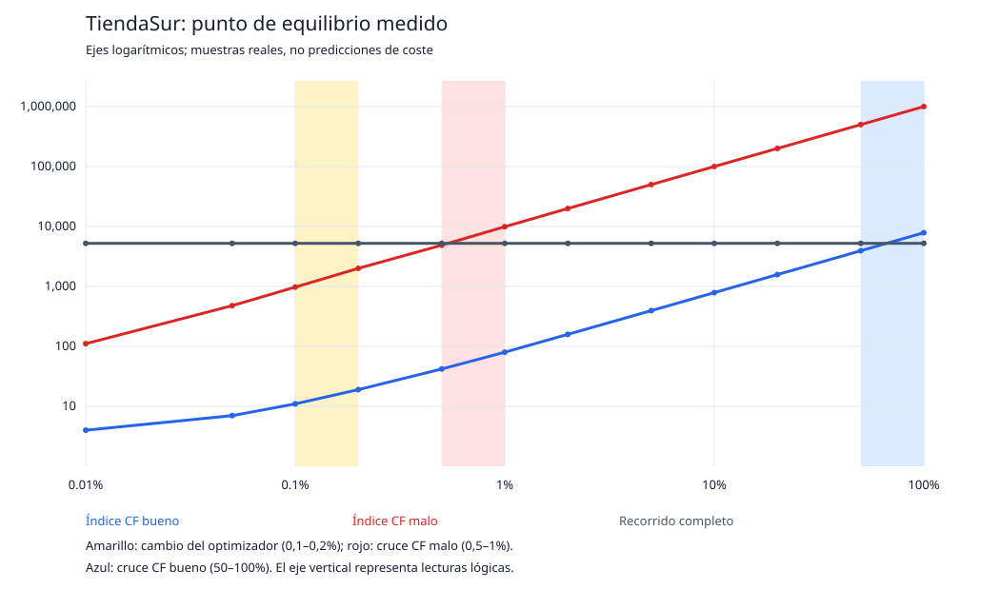

# Laboratorio 5 · Oracle DBA Workflow II v3

Autor: Pablo García Martínez. Fecha: 27 de octubre de 2026. Entorno: WSL, Oracle AI Database Free 23.26.3.0.0. Enunciado de referencia: v3, 21 de octubre de 2026. Las horas y los nombres de evidencia están en UTC.

## Preguntas de comprobación

1. **Cobertura de las copias.** El paso 6 de lab4-final indica que no hay archivos externos al volumen. En mi copia lab3-final también indicaba ninguno: aquella imagen ya enlazaba dbs al volumen, aunque los cinco datafiles de negocio tenían rutas aparentes fuera de FREE/FREEPDB1. La diferencia real está en las rutas estándar y los límites aplicados, no en inventar archivos perdidos en la copia anterior. La copia inicial de este laboratorio es `20261027T165012Z_lab4-final`, unos 690 MiB, SHA-256 y gzip correctos; no se ha vuelto a crear para repetir la validación. [00].

2. **Factor de bloqueo.** En el perfil inicial, CLIENTE tiene 100.000 filas/1.517 bloques = **65,92 filas/bloque**, R=102; PEDIDO, 1.000.000/5.320 = **187,97**, R=32. PEDIDO almacena casi 2,85 veces más filas por bloque porque sus filas son más cortas. Al contar bloques con ROWID BIGFILE se observan 5.220 bloques de PEDIDO con filas, mínimo 2, media **191,57**, máximo 200. HWM, metadatos, bloques parcialmente llenos y longitudes variables explican que no coincida con r/BLOCKS. El perfil es anterior a la corrección de codificación descrita al final. [01], [01-verificacion].

3. **Dos ejecuciones.** La primera analiza la sentencia y calienta sus bloques; la segunda mide una situación comparable de caché caliente. No elimina todo ruido ni mide el coste del disco frío. MEDIR usa diferencias de estadísticas de sesión y consume todas las filas con DBMS_SQL; su prueba PK devuelve una fila con **4 lecturas lógicas**, cero físicas. [01-medir].

4. **Altura y ramificación.** IX_PED_CLIENTE: altura **3**, 2.216 hojas, seis bloques de rama y un millón de entradas. Fan-out real `(2216+6−1)/6≈370`; máximo calculado **543**, 451 entradas por hoja frente a máximo 503. Con mil millones de filas y esas hipótesis se estiman **2.208.969 hojas, altura 4 y cinco lecturas** para índice más tabla. No es una altura lineal con el número de filas. [02].

5. **ROWID corto en la hoja.** La primera entrada de PK_CLIENTE tiene clave `c1 02`, número 1, y `data:(6): 00 00 03 1b 00 00`: bloque **0x31b=795**, ranura **0**. DBMS_ROWID del cliente 1 confirma ambos. El contexto del índice y del tablespace BIGFILE identifica el archivo; la entrada no necesita repetir el número absoluto de archivo en esos seis bytes. La raíz está en bloque 787 y su primer hijo en 789. [02].

6. **Tres comparaciones.** DNI único: **1.486→3** lecturas, además rechaza realmente el duplicado con ORA-00001. Q7: índice simple **15**, compuesto **7**, cubriente **3** lecturas, para las mismas cuatro filas; el cubriente evita la tabla y el sort. En la búsqueda por token, heap+PK **4**, IOT **3**, hash **1**; la limpieza por rango en hash cuesta **2.770**. Otra comparación relevante: los cuatro bitmaps reducen la agregación de **4.073→528**, en una tabla de hechos sin DML concurrente. [03].

7. **Clustering factor.** Los pedidos se insertan por fecha/ID creciente, por lo que IX_PED_FECHA y PK_PEDIDO tienen CF **5.220**, cercano a los bloques con filas. ID_CLIENTE llega disperso: IX_PED_CLIENTE tiene **999.041**, casi un salto de bloque por entrada. El cálculo con LAG en el orden del índice reproduce ambos valores. REBUILD reorganiza el índice, no las filas de la tabla, y no arregla esa dispersión. [04].

8. **Punto de equilibrio.** El índice con CF malo lee **4.875** bloques al 0,5 % y **9.920** al 1 %, frente a **5.232** del recorrido completo: el cruce observado está entre 0,5–1 %. El bueno pasa de **3.938** al 50 % a **7.875** al 100 %: cruza entre 50–100 %. El optimizador ya elige full scan desde el 0,2 %, antes del cruce de lecturas lógicas, porque su coste incorpora accesos aleatorios y otras estimaciones. La fórmula lógica `1/bfr≈1/188` predice **0,53 %** para CF malo; con coste secuencial/aleatorio=1/5, **0,11 %**. [04].



El eje horizontal es logarítmico; se conserva también el [CSV de las doce muestras](lab5/evidencia/config/04-curva-equilibrio.csv). Las bandas señalan intervalos entre muestras, no un umbral exacto interpolado que se haya medido. El cruce de lecturas, el cruce de costes físicos y la elección estimada del optimizador son criterios distintos.

9. **Sargable no equivale a barato.** Q4b devuelve **2.056 filas** con INDEX RANGE SCAN y **2.024 lecturas**. El recorrido completo de CLIENTE en las otras pruebas cuesta unas **1.486**; las filas de apellidos próximos están dispersas por la tabla. El índice permite buscar el prefijo, pero visitar muchas filas dispersas puede costar más bloques. Q4a con comodín inicial devuelve 18.902 filas y hace full scan, **1.523 lecturas** con el tamaño de fetch de esa consulta. [05].

10. **Coste de escritura.** Para 2.000 INSERT de una fila: cuatro índices, **20.314/2000=10,157 bloques/fila**; nueve, **40.372/2000=20,186**; V005 con cinco, **24.242/2000=12,121**. Se rechazan CANAL (33,333 % por valor y no usado), FEC_CLI (no usado y redundancia con la ruta de fecha), ESTADO completo (se sustituye por el parcial de 20.000 pendientes), IMPORTE (no usado y Q2 mantiene 329 lecturas al hacerlo invisible) y CLIENTE aislado (prefijo del cubriente). La observación es experimental y corta; no demuestra ausencia de uso anual en una aplicación real. La llamada «propuesta del compañero» es un caso hipotético del enunciado, no una revisión real de otra persona. [06-inicial], [06-propuesta], [06-protocolo], [06-final].

11. **Patrones de hojas.** AZAR: **595 splits**, ninguno 90/10, 596 hojas y **75,4 %** de ocupación viva; no hay que forzar el 69 % teórico en una muestra finita. CRECIENTE: **398 splits, todos 90/10**, 399 hojas y **99,9 %** de ocupación. REVERSE reparte la inserción: 511 splits, ninguno 90/10, 512 hojas y 77,9 %, pero el rango probado pasa de **4→878 lecturas**. La cola tiene 425 hojas, **224 vacías**, 70.619 entradas borradas y mapa izquierdo vacío/derecho lleno. [07a], [07-cola].

12. **Remedio.** COALESCE reduce la cola de **425→201 hojas** y el siguiente mensaje de **226→2 lecturas**, sin bajar los **4 MiB** del segmento. SHRINK baja a **1,69 MiB** sin mejorar esas dos lecturas; REBUILD deja 223 hojas y 2 MiB, también dos lecturas. Para ese síntoma elegiría COALESCE con ventana y observación acordadas; a largo plazo revisaría la purga y el particionado. El diagnóstico se publicó en el [Issue #6](https://github.com/garmaar/oracle-database-lab/issues/6#issuecomment-6448456043), aclarando que es el caso reproducible del kit, no una prueba ciega suministrada por el profesor. [07-remedios].

13. **SCN y cabeceras.** Antes del checkpoint, control file y cabecera de Academia coinciden en **6.396.476**; después coinciden en **6.402.703**, mientras CURRENT_SCN ya es **6.402.780**. Oracle compara los checkpoints registrados para decidir recuperación; CURRENT_SCN no tiene por qué igualar ese último checkpoint. La semilla conserva su SCN antiguo por ser READ ONLY. En el reto sin checkpoint, ACTUAL_REDO_BLKS sube **487.029→490.692**, pero ESTIMATED_MTTR permanece **19 s**: no se ha inventado un crecimiento de ambos. [08].

14. **Control files.** La tercera copia tiene el mismo SHA-256 que la sana con la base detenida. Tras arrancar hay tres rutas activas y persistidas en SPFILE. Todas están en el mismo volumen: protegen frente a perder un archivo, no frente a perder ese almacenamiento. En producción se separarían en dominios de fallo y se protegerían las copias de recuperación. [09].

15. **Estados de redo y una corrección al kit.** CURRENT es el grupo que recibe redo; ACTIVE puede seguir siendo necesario para recuperación; INACTIVE ya no lo necesita para recuperación de instancia. Archivar y dejar de estar ACTIVE son condiciones diferentes. Los intentos de quitar el CURRENT y un miembro suyo producen **ORA-01623 y ORA-01609**. El tercer intento del kit no es necesariamente ilegal: con tres grupos, quitar uno dejaría dos, no uno. Se protegió esa demostración y se registró **NO EJECUTADO** en vez de arriesgar un DROP válido o inventar un tercer rechazo. Se conservaron tres grupos con dos miembros cada uno. Un miembro siguió INVALID tras los primeros switches; un checkpoint y rotación acotada lo inicializaron y la comprobación posterior dio cero INVALID/STALE. [10], [10-check].

16. **FRA llena.** Sin tamaño configurado, fijar la ruta da ORA-02097/ORA-19802. Después se configura 4 GiB y, en el escenario controlado, se baja solo en memoria a **2 MiB**: aparece **ORA-19815** al 100 %, **ORA-19809** y **ORA-16038** al intentar archivar la secuencia 22. Al no poder archivar, los grupos no pueden reutilizarse indefinidamente y la actividad puede acabar esperando por archivado. Se devolvió memoria a 4 GiB y se volvió a archivar; la verificación confirma **4.294.967.296 bytes** en memoria y SPFILE, cuatro archived logs en FRA y unos **8,5 MiB** usados. La base ya estaba en ARCHIVELOG desde Lab 4: no se repitió el cambio de modo ni su reinicio. [11].

17. **Consistencia y bloqueos.** La sesión A (SID **67**) cambia 101 sin confirmar; B sigue viendo ACTIVO gracias al undo. A consume un bloque y un registro de undo, con TM modo 3 y TX modo 6. B puede leer, pero su SELECT FOR UPDATE WAIT 3 produce **ORA-00054/ORA-40097**. Después del COMMIT, B ve EGRESADO; AS OF devuelve ACTIVO y permite reparar la fila. Esto distingue lectores de otros escritores que intentan bloquear la misma fila. [12-consistencia].

18. **Undo y redo.** En la primera muestra de 10.000 operaciones, INSERT usa **143 bloques de undo/1.144 KiB**, UPDATE **71/568 KiB**, DELETE **427/3.416 KiB**. El DELETE necesita conservar la información necesaria para reconstruir filas e índices, no solo indicar qué nueva fila debe eliminarse al deshacer. El redo total fue **4.890, 1.258 y 6.627 KiB**, respectivamente; sus rollback generan **357, 751 y 4.700 KiB** adicionales. Cambiar bloques de undo también requiere redo para poder reconstruirlos tras una caída. [12-undo].

19. **Durabilidad y checkpoint.** Tras UPDATE+COMMIT de 20.000 estudiantes: **8.370 KiB de redo**, 11 escrituras LGWR, un commit, **cero escrituras de caché de DBWn** y **231 buffers de la tabla sucios**. Tras checkpoint hay 612 escrituras de caché de toda la instancia y **cero buffers de esa tabla sucios**. La garantía del COMMIT síncrono está en el redo persistido; no exige que cada bloque de datos esté ya escrito. Las cifras de V$SYSSTAT incluyen actividad interna, por eso 612 no se interpreta como 612 bloques exclusivos de la tabla. [13].

20. **Recuperación de instancia.** Tras SHUTDOWN ABORT se observó 102=EGRESADO (COMMIT conservado) y 103=ACTIVO (UPDATE sin confirmar deshecho). El alert log registra redo scan de **20 KiB** y **17 bloques que necesitan recuperación**, aplicación y recuperación completada. RTO medido desde que termina ABORT hasta CDB/PDB disponibles: **9 s**; RPO de transacciones confirmadas: **0**. Se devuelve 102 a ACTIVO y se comprueban las cuatro filas de control. [14a].

21. **Restauración completa frente a recuperación de archivo.** C tarda **390 s en restaurar la copia completa**, recupera 60.000 matrículas y todo el banco; no incluye el tiempo de crear/verificar la copia previa. D tarda **11 s de reparación, 12 s desde el fallo**, y conserva 104=EGRESADO, confirmado después del backup: **RPO 0 demostrado para ese cambio**. C vuelve al estado de la copia y puede perder cualquier cambio posterior. El guion informa de una ventana de **3 s**, pero su variable se toma después de verificar el archivo comprimido, no al checkpoint de la copia; no debe presentarse como una medida exacta del RPO desde el punto frío. Tampoco se simuló otra carga de negocio confirmada en esa ventana para cuantificar pérdidas adicionales. [14c], [14d].

22. **Errores del runbook.** ORA-01110/01113/63999 de las 17:35 son efectos del simulacro D y su transición de PDB; aunque el alert log conserva menciones a archivos 24 y 34, la comprobación actual encuentra cero cabeceras con ERROR/RECOVER pendiente y V$RECOVER_FILE vacío. ORA-00202/00205 (también escrito ORA-205) corresponden al control file eliminado en B. ORA-00800 (VKTM/LGWR, Set Priority Failed) es el aviso de prioridades del entorno WSL/contenedor: conocido, pero se investigaría antes de usarlo en producción. En el periodo completo también están ORA-19815/19809 por FRA llena y ORA-01623/01609 por los DROP rechazados de K. No se detecta un fallo de recuperación pendiente actual; conservar el error histórico no significa que siga activo. [15], [15-extra].

## Retos y correcciones verificadas

**Estimación previa de UX_CLI_EMAIL.** Con entrada supuesta de 30 bytes, 7.996 bytes útiles y fo máximo 543 tomado del índice numérico: 266 entradas/hoja, 418 hojas al 90 % y altura estimada **2**. INDEX_STATS muestra **altura 3, 501 hojas y tres ramas**. La clave de email no tiene el tamaño de la clave numérica usada para transferir el fan-out: las hipótesis del cálculo no se cumplen exactamente. Su mapa ronda 89,6 % de ocupación frente al 99,6 % de PK_CLIENTE; ambas tienen 100.000 entradas, pero distinta longitud y orden lexicográfico de llegada. [02-email].

**Q9 cubriente.** No añadiría un índice enorme solo para evitar la tabla en esa consulta: devuelve 20 filas con **5 lecturas**, mientras el índice de fecha ocupa **22 MiB** y PEDIDO **42 MiB**. Un índice que añadiera todas las columnas encarecería cada escritura para ahorrar muy pocos accesos en esta muestra. [03-reto].

**Revisión hipotética de la consulta del panel.** SUBSTR sobre teléfono oculta el prefijo indexado; UPPER(apellidos) no utiliza un índice ordinario del apellido. Se midió una propuesta que convierte el teléfono a rango `[600,601)` y separa las ramas con UNION, preservando UPPER con un índice funcional para no cambiar la comparación sin distinguir mayúsculas. Original: **981 filas, 1.487 lecturas**; propuesta: mismas 981 filas, **1.489 lecturas**. Los MINUS en ambos sentidos dan cero diferencias. El optimizador sigue prefiriendo full scan para el rango: no se recomienda añadir esos dos índices solo porque la sintaxis sea sargable. Los dos índices de prueba se eliminaron. Es un comentario de revisión diseñado para el reto, no una conversación real con un compañero. [05-reto].

**Índice propio V006, rechazado.** Rama separada `experiment/lab5-v006-fecha-importe`. Q11 pasa de **5.008 lecturas** sobre el cubriente de V005 a **3.340** con un índice (fecha_pedido, importe) de **27 MiB/3.321 hojas**. INSERT pasa de **24.242→28.251 bloques/2.000 filas** (12,121→14,126 por fila); UPDATE de importe, **12.080→20.130**. El índice de fecha existente es prefijo del candidato. Para justificarlo habría que demostrar una frecuencia de Q11 que compensara escrituras y almacenamiento: la muestra no demuestra tal carga, por lo que se retira del entorno y no se fusiona su migración. Se conservan exactamente los índices de V005. [06-reto].

**Corrección de UTF-8 hacia delante.** El cargador heredado no fijaba NLS_LANG y V004 introdujo U+FFFD en **65.616 apellidos**; por ejemplo Pérez se veía con caracteres de sustitución. Se fijó `.AL32UTF8` y se aplicó `V004_1__reparar_texto_tiendasur.sql`, regenerando solo esos apellidos con las mismas reglas deterministas del kit. No se reescribió V004 ni se recargó el banco. Después hay **cero U+FFFD**, cliente 1=Pérez Castro y los mismos 100.000/1.000.000 registros, sin huérfanos. Las evidencias B–F anteriores se conservan como medidas de aquel estado; los experimentos posteriores usan el texto corregido. [01-utf8].

**Crecimiento de FRA por DML y rollback.** El reto repite las operaciones conforme al enunciado y fuerza archivado. FRA pasa de **8.950.784→47.396.864 bytes**, aumento de **38.446.080 bytes = 36,66 MiB**. La segunda muestra genera 4.026+1.258+6.623 KiB de redo de las operaciones, más 341+751+4.701 KiB al deshacer. La suma no tiene por qué ser igual al incremento de FRA: el archivado incorpora redo acumulado desde antes, trabajo interno, rollback y granularidad de archivos. Los datos se conservan mediante ROLLBACK. [12-fra].

**Dimensionamiento de redo.** La carga inicial de V004 ocurrió entre 16:58 y 16:59 UTC. El historial muestra **un cambio en la hora 16**: los grupos actuales de **200 MiB** ya cumplen el objetivo de no superar cuatro cambios en esa carga. La hora 17 incluye muchos switches forzados por los experimentos, y no equivale a una hora de carga natural ni demuestra que cada archivo tuviera 200 MiB de redo útil. No se justifica redimensionar a partir de esos switches artificiales. Si una futura medida real exigiera migrar o separar discos, una alternativa de 256 MiB se prepararía así, **sin ejecutar estos comandos aquí**:

```sql
ALTER DATABASE ADD LOGFILE GROUP 4 ('/u02/redo04a.log','/u03/redo04b.log') SIZE 256M;
ALTER DATABASE ADD LOGFILE GROUP 5 ('/u02/redo05a.log','/u03/redo05b.log') SIZE 256M;
ALTER DATABASE ADD LOGFILE GROUP 6 ('/u02/redo06a.log','/u03/redo06b.log') SIZE 256M;
ALTER SYSTEM SWITCH LOGFILE;
ALTER SYSTEM CHECKPOINT;
ALTER SYSTEM ARCHIVE LOG CURRENT;
SELECT group#,status,archived,members FROM v$log;
```

Solo cuando la carga use los nuevos grupos y cada grupo antiguo esté INACTIVE y archivado se retiraría con DROP LOGFILE GROUP 1/2/3, verificando cada estado y manteniendo al menos dos grupos válidos. `/u02` y `/u03` representan almacenamiento independiente planificado, no directorios disponibles en este laboratorio. [10-check], [15-extra].

**Alerta de guardia.** `15-alerta-fra.sql` devuelve como máximo una fila cuando `space_used > 0.85*space_limit`. Con FRA al **2,4 %**, no devuelve filas; no se volvió a llenar la FRA para probarla. El healthcheck registra una copia RMAN COMPLETED de unos 38 MiB y 27 s de trabajo total, que no se confunden con los 11 s de reparación del datafile. [15].

## Simulacros: RTO/RPO y retrospectiva

Son tiempos observados en este equipo, con reloj de resolución de un segundo, no objetivos contractuales de servicio.

| Simulacro | Intervalo medido | RPO y prueba | Sorpresa / mejora del procedimiento |
|---|---|---|---|
| A: caída | **9 s**, fin de ABORT→CDB/PDB disponibles. | **0 de transacciones confirmadas**: 102=EGRESADO sobrevive y 103 vuelve a ACTIVO. | La recuperación lee 20 KiB y repara 17 bloques automáticamente. Mantener una fila confirmada y otra pendiente como prueba. |
| B: control file | **6 s desde pérdida**, de los cuales **5 s de reparación**. No incluye la parada preparatoria. | **0**: copia sana de cierre limpio; tres control files y datos conservados. | La instancia queda STARTED/NOMOUNT. Reparar solo la copia faltante, sin restaurar datafiles. |
| C: tabla purgada | **390 s** de restauración completa; se verifica después el servicio. | Regreso al estado de copia; todo cambio posterior está en riesgo. Ventana reportada de 3 s tras validación, no RPO exacto del checkpoint. | La papelera recupera primero 60.000 filas; con PURGE hace falta otra técnica. Añadir un marcador confirmado posterior a la copia y un timestamp del checkpoint en un futuro simulacro, sin repetir este solo para mejorar la métrica. |
| D: datafile | **12 s desde fallo**, **11 s reparación**. | **0 demostrado**: 104=EGRESADO, posterior al backup, aparece tras RECOVER. Después vuelve a ACTIVO. | Oracle cerró FREEPDB1 (ORA-63999); hubo que recuperar con la PDB MOUNTED y reabrirla. El runbook incluye ambos caminos. |

La restauración de C mueve todo el volumen y retrocede al backup; D restaura solo Academia y aplica redo. No son intercambiables. La mejora prioritaria es conservar marcadores y tiempos de cada fase, copias verificadas y almacenamiento de control files/redo en dominios de fallo independientes. El [runbook de pérdida de datafile](../runbooks/perdida-datafile.md) permite actuar sin haber realizado el laboratorio.

**Estado técnico final:** CDB y FREEPDB1 READ WRITE, ARCHIVELOG, tres control files, tres grupos con dos miembros válidos, FRA de 4 GiB, MEDIR válido, 100.000 clientes/1.000.000 pedidos, 60.000 matrículas y filas 101–104 ACTIVO. Cero apellidos con U+FFFD, índices inválidos o recuperación pendiente. El verificador [16] termina **TODO OK**.

## Preguntas intercaladas del enunciado

| Pregunta | Respuesta | Justificación y evidencia |
|---|---|---|
| B1 | B | Una distribución sesgada sin histograma explica una mala estimación por valor; el banco sí tiene histograma FREQUENCY de ESTADO. [01] |
| C1 | C | BLEVEL 2 son tres niveles, más un bloque de tabla para una columna no cubierta: cuatro lecturas. [02] |
| C2 | C | Altura=1+ceil(log500(2000000))=4. |
| D1 | B | Bitmap por columna para combinar filtros de baja cardinalidad con carga no concurrente. [03] |
| D2 | A, C | Evita tabla si cubre columnas, a costa de mantener más datos al escribir. [03] |
| E1 | B | CF próximo a filas y 3 % implican muchos saltos; full scan razonable. [04] |
| F1 | B | Número contra VARCHAR2 aplica conversión a la columna. [05] |
| F2 | A y C con precisión de segundos | A es el rango semiabierto general. C equivale para DATE/valores sin fracciones; no para un TIMESTAMP que admita fracciones después de 23:59:59. No hay dos opciones universalmente equivalentes sin esa hipótesis. |
| G1 | B | INVISIBLE conserva mantenimiento y permite volver a VISIBLE al instante. [06-protocolo] |
| G2 | B | Un índice extra añade aproximadamente dos bloques modificados por fila: 500×2≈1000/s. [06-inicial], [06-propuesta] |
| H1 | B | COALESCE elimina el recorrido de hojas vacías con menor coste que reconstruir. [07-remedios] |
| H2 | A, C | REVERSE distribuye claves crecientes pero pierde el orden útil para rangos. [07a] |
| I1 | B | Compara checkpoints del control file y la cabecera. [08] |
| J1 | B | No se ignora una copia configurada que falla; hay que repararla o retirar su referencia y arrancar. [09] |
| J2 | A, C | Control file registra estructura física y checkpoints; parámetros y contraseñas van en otros archivos. [09] |
| K1 | C | ACTIVE puede seguir siendo necesario para recuperación de instancia, aunque ya esté archivado. [10] |
| L1 | B | Debe fijarse antes DB_RECOVERY_FILE_DEST_SIZE. [11] |
| L2 | A, C | Ampliar capacidad o respaldar y eliminar archivados mediante RMAN; no borrar .arc manualmente. [11] |
| M1 | C | Lectura consistente del último valor confirmado mediante undo. [12-consistencia] |
| M2 | C | DELETE conserva datos para poder reconstruir filas e índices. [12-undo] |
| M3 | B, D | Retención y capacidad de undo; GUARANTEE protege consultas a costa de poder rechazar escrituras. |
| N1 | A | El COMMIT síncrono garantiza redo online persistido, no checkpoint ni archivado. [13] |
| N2 | B, C | Checkpoint y presión de buffers pueden hacer escribir a DBWn; no cada COMMIT. [13] |
| O1 | B | Recuperación automática aplica redo y deshace lo no confirmado. [14a] |
| O2 | B, D | Reparar con copia sana o retirar la referencia ausente del SPFILE y reiniciar. |
| O3 | B | OFFLINE, RESTORE, RECOVER y ONLINE para un datafile de aplicación, si la PDB sigue abierta. |
| O4 | D | RECOVER TABLE puede recuperar una tabla purgada sin retroceder otras tablas; la papelera ya no basta. |

## Simulacro de examen S1–S26

| Pregunta | Respuesta | Justificación y parte |
|---|---|---|
| S1 | B | CF alto implica accesos dispersos a tabla; no se arregla con REBUILD. E. |
| S2 | A, C | Índice sobre la expresión o normalización compatible de email y valor. D/F. |
| S3 | B | TO_NUMBER sobre la columna de texto impide el acceso ordinario por su índice. F. |
| S4 | B | Baja cardinalidad y carga nocturna sin DML concurrente: bitmap. D. |
| S5 | B | SKIP SCAN puede usar la segunda columna recorriendo prefijos. D. |
| S6 | B | INVISIBLE permite probar dependencia con marcha atrás rápida. G. |
| S7 | A, C | COALESCE y SHRINK tratan el espacio desaprovechado con operaciones en línea. H. |
| S8 | B | Distribuye inserciones y deja de ser útil para rangos sobre la clave original. H. |
| S9 | C | Un UPDATE de columna no indexada no mantiene todos esos índices por ese motivo; puede haber otros costes de tabla. G. |
| S10 | B | El tamaño de entradas determina fan-out y capacidad por nivel. C. |
| S11 | A, C | La IOT guarda filas en el índice de la PK y evita un heap aparte en esa búsqueda. D. |
| S12 | B | Comparación del checkpoint registrado en control file y cabecera. I. |
| S13 | C | CKPT actualiza la información de checkpoint; DBWn escribe bloques de datos. I/N. |
| S14 | B, E | NOMOUNT permite V$INSTANCE y V$PARAMETER, no las estructuras que requieren montar/abrir. Lab 4 E y Lab 5 O. |
| S15 | B | Parada limpia, MOUNT, ARCHIVELOG y OPEN; mi base ya estaba en ARCHIVELOG y no repitió la transición. L. |
| S16 | B | CLEAR LOGFILE permite recrear el grupo INACTIVE archivado perdido; no lo hace SMON automáticamente. K. |
| S17 | A, C | Undo permite lectura consistente y consultas AS OF, además de rollback. M. |
| S18 | B | Hay que poder reconstruir bloques de undo antes de deshacer transacciones tras una caída. M. |
| S19 | A | En COMMIT síncrono el redo está en el log online; no exige datos ya escritos ni redo archivado. N. |
| S20 | A | Un objetivo menor aumenta el trabajo de checkpoint para acotar recuperación; no es retención de undo. I. |
| S21 | B | Si ARCn no puede archivar, los logs pendientes no se reutilizan y aparece la espera. L. |
| S22 | B | Si es viable, aislar el archivo de aplicación para mantener el resto del servicio; comprobar antes el estado de la PDB. O. |
| S23 | B | SYSTEM de la raíz requiere recuperación con la base montada; no la misma ruta online de un tablespace de aplicación. O. |
| S24 | B | Sin redo archivado no se promete recuperación de medios completa: restauración consistente y pérdida posterior. O. |
| S25 | B, D | Retención/capacidad de undo y, si procede, RETENTION GUARANTEE, vigilando su impacto en escrituras. M. |
| S26 | A | V$RECOVERY_AREA_USAGE desglosa espacio de FRA por tipo. L/P. |

La restricción de un mínimo de dos grupos y las condiciones de DROP se contrastaron con [Oracle 26ai: Managing the Redo Log](https://docs.oracle.com/en/database/oracle/oracle-database/26/admin/managing-the-redo-log.html). No se ejecutaron pérdidas adicionales para demostrar preguntas teóricas.

## Referencias

[00]: lab5/evidencia/script/20261027T165837Z_00-verificacion-backup.script.log
[01]: lab5/evidencia/script/20261027T165934Z_01-perfil-tiendasur.script.log
[01-verificacion]: lab5/evidencia/script/20261027T165943Z_01-verificacion.script.log
[01-medir]: lab5/evidencia/script/20261027T165936Z_01-herramienta-medir.script.log
[01-utf8]: lab5/evidencia/spool/20261027T170646Z_01-V004_1__reparar_texto_tiendasur.spool.log
[02]: lab5/evidencia/script/20261027T170008Z_02-anatomia-indice.script.log
[02-email]: lab5/evidencia/script/20261027T170010Z_02-reto-email.script.log
[03]: lab5/evidencia/script/20261027T170041Z_03-tipos-indice.script.log
[03-reto]: lab5/evidencia/script/20261027T170254Z_03-reto-cubriente.script.log
[04]: lab5/evidencia/script/20261027T170254Z_04-agrupamiento-equilibrio.script.log
[05]: lab5/evidencia/script/20261027T170415Z_05-sargabilidad.script.log
[05-reto]: lab5/evidencia/script/20261027T170420Z_05-reto-revision.script.log
[06-inicial]: lab5/evidencia/script/20261027T170516Z_06-dml-inicial.script.log
[06-propuesta]: lab5/evidencia/script/20261027T170556Z_06-dml-propuesta.script.log
[06-protocolo]: lab5/evidencia/script/20261027T170558Z_06-protocolo.script.log
[06-final]: lab5/evidencia/script/20261027T170715Z_06-dml-v005.script.log
[06-reto]: lab5/evidencia/script/20261027T170810Z_06-reto-propio.script.log
[07a]: lab5/evidencia/script/20261027T170904Z_07a-crecimiento.script.log
[07-cola]: lab5/evidencia/script/20261027T170904Z_07b-patron-cola.script.log
[07-remedios]: lab5/evidencia/script/20261027T170904Z_07c-remedios.script.log
[08]: lab5/evidencia/script/20261027T171109Z_08-scn-checkpoint.script.log
[09]: lab5/evidencia/script/20261027T171233Z_09-multiplexar-controlfile.script.log
[10]: lab5/evidencia/script/20261027T171314Z_10-redo.script.log
[10-check]: lab5/evidencia/script/20261027T171416Z_10-verificacion-corregida.script.log
[11]: lab5/evidencia/script/20261027T171506Z_11-fra-llena.script.log
[12-consistencia]: lab5/evidencia/script/20261027T171552Z_12-lectura-consistente.script.log
[12-undo]: lab5/evidencia/script/20261027T171626Z_12-undo-y-redo.script.log
[12-fra]: lab5/evidencia/script/20261027T171646Z_12-reto-fra.script.log
[13]: lab5/evidencia/script/20261027T171721Z_13-lgwr-dbwn.script.log
[14a]: lab5/evidencia/script/20261027T171801Z_14a-caida-instancia.script.log
[14c]: lab5/evidencia/script/20261027T171950Z_14c-simulacro-restauracion.script.log
[14d]: lab5/evidencia/script/20261027T173423Z_14d-perdida-datafile.script.log
[15]: lab5/evidencia/spool/20261027T173640Z_15-healthcheck.spool.log
[15-extra]: lab5/evidencia/script/20261027T173755Z_15-verificacion-adicional.script.log
[16]: lab5/evidencia/script/20261027T173645Z_16-verificacion-final.script.log
